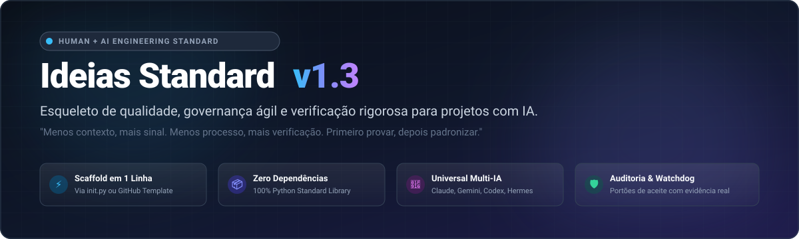
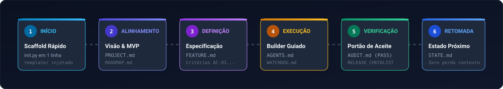

<p align="center">
  
</p>

<p align="center">
  <a href="https://github.com/playertwo1/ideias_standard"></a>
  <a href="https://python.org"></a>
  <a href="https://github.com/playertwo1/ideias_standard/generate"></a>
  
  
</p>

---

## 💡 O que é o Ideias Standard?

O **Ideias Standard** é um kit de **governança, scaffolding ágil e verificação rigorosa** para projetos construídos por pessoas e agentes de IA (*Claude, Codex, Gemini, Hermes, GPT-4...*).

Em vez de iniciar cada projeto do zero — perdendo o contexto entre sessões, acumulando roadmaps infinitos e confiando em "a IA disse que fez" —, você inicializa um projeto com um comando de 1 segundo e já obtém:
1. **Visão e MVP delimitados** (`PROJECT.md`)
2. **Roadmap com marco ativo observável** (`ROADMAP.md`)
3. **Ponto de retomada imediata** para qualquer agente ou pessoa (`STATE.md`)
4. **Guardião de execução em tempo real** contra desvios de escopo (`WATCHDOG.md`)
5. **Auditoria final independente** com critérios severos de aprovação (`AUDIT.md`)
6. **Validador estático zero-dependências** (`scripts/check.py`)

> **Princípios do Standard:**
> * Menos contexto, mais sinal.
> * Menos processo, mais verificação.
> * Primeiro provar, depois padronizar.
> * `NOT_RUN` não é `PASS`; afirmação de IA não é evidência.

---

## ⚡ Início Rápido (1 segundo)

Você **não precisa clonar este repositório** para usá-lo. Escolha a sua forma preferida:

### Método 1: PowerShell (Windows) — 1 Linha
Abra o PowerShell na pasta onde deseja criar o projeto e execute:
```powershell
irm https://raw.githubusercontent.com/playertwo1/ideias_standard/main/scripts/init.py | python - meu-projeto
```

### Método 2: Curl / Bash (Linux / macOS) — 1 Linha
```bash
curl -sSL https://raw.githubusercontent.com/playertwo1/ideias_standard/main/scripts/init.py | python3 - meu-projeto
```

### Método 3: Template Oficial no GitHub
- Pelo navegador: clique no botão verde [**Use this template**](https://github.com/playertwo1/ideias_standard/generate) no topo desta página.
- Pelo GitHub CLI (`gh`):
  ```bash
  gh repo create meu-projeto --template playertwo1/ideias_standard --public
  ```

### Método 4: Localmente (se já clonou o repositório)
```bash
python scripts/init.py ../meu-projeto
# Para projetos backend/CLI sem interface visual:
python scripts/init.py ../minha-api --no-design
```

---

## 🔄 Ciclo de Trabalho Ponta a Ponta

<p align="center">
  
</p>

O fluxo garante que cada linha de código entregue tenha uma razão de existir e uma prova real de funcionamento:

| Etapa | Responsável | Documento Base | O que acontece |
|:---|:---:|:---|:---|
| **1. Início** | Dev / IA | `scripts/init.py` | Estrutura limpa injetada em 1 comando. |
| **2. Alinhamento** | Produto / Dev | [`PROJECT.md`](template/PROJECT.md), [`ROADMAP.md`](template/ROADMAP.md) | Problema real, o que fica **fora** do MVP e um único marco ativo com demonstração palpável. |
| **3. Definição** | Dev / IA | [`docs/templates/FEATURE.md`](template/docs/templates/FEATURE.md) | Critérios de Aceite (AC-01, AC-02...) e testes esperados antes de codificar. |
| **4. Execução** | Builder (IA) | [`AGENTS.md`](template/AGENTS.md), [`docs/WATCHDOG.md`](template/docs/WATCHDOG.md) | Mudança mínima correta. O *Watchdog* interrompe desvios de escopo e edições desnecessárias. |
| **5. Verificação** | Auditor | [`docs/AUDIT.md`](template/docs/AUDIT.md), [`docs/RELEASE_CHECKLIST.md`](template/docs/RELEASE_CHECKLIST.md) | Revisão independente: diff, gates de teste, checagem de atalhos e emissão de `PASS` ou `FAIL`. |
| **6. Retomada** | Dev / IA | [`STATE.md`](template/STATE.md) | Sincroniza o que parou e a **próxima ação**. A próxima sessão retoma sem ler conversas antigas. |

---

## 📊 Por que usar? (Caos habitual vs. Ideias Standard)

| Situação | Sem o Standard (O modo frágil) | Com o Ideias Standard |
|---|---|---|
| **Troca de sessão / modelo de IA** | A IA perde o fio da meada, inventa código novo ou refaz o que já estava pronto. | O agente lê apenas `STATE.md` e `ROADMAP.md` e continua exatamente de onde parou. |
| **Escopo do projeto** | "Vamos adicionar autenticação, microsserviços, cache..." antes de validar o produto. | Seção explícita **Fora do MVP** no `PROJECT.md` barra desperdício de tempo e código. |
| **Tamanho do Contexto** | Prompts gigantes com 500 linhas de regras que cansam o modelo e aumentam custo. | `AGENTS.md` tem limite rígido de 120 linhas; regras secundárias ficam em `docs/`. |
| **Critério de Pronto** | "A IA disse que fez, então está pronto." | `AUDIT.md` e `RELEASE_CHECKLIST.md` exigem comando executado e evidência observável. |
| **Dependências de tooling** | Ferramentas pesadas de CLI com dezenas de dependências em `node_modules` ou `venv`. | Zero dependências: só arquivos Markdown e Python Standard Library. |

---

## 📁 Anatomia do Kit (`template/`)

Ao rodar o `init.py`, seu projeto recebe esta arquitetura limpa:

```text
meu-projeto/
├── README.md               # Como rodar, verificar e construir o projeto
├── PROJECT.md              # Por que existe, para quem, fluxos do MVP, fora de escopo
├── ROADMAP.md              # Marcos com demonstração real (apenas 1 marco ativo por vez)
├── STATE.md                # Onde paramos e a próxima ação (o ponto de entrada de qualquer IA)
├── AGENTS.md               # As 10 regras universais para agentes + comandos de execução locais
├── CLAUDE.md               # Aponta para @AGENTS.md (zero duplicação de regras)
├── DESIGN.md               # Tokens, paleta, componentes e tipografia (opcional; apague se não houver UI)
├── CHANGELOG.md            # Histórico de versões observáveis
├── .gitignore, .editorconfig
└── docs/
    ├── DECISIONS.md        # O porquê das escolhas arquiteturais caras de desfazer
    ├── RELEASE_CHECKLIST.md# Portões de qualidade (G1..G8) e validação final
    ├── WATCHDOG.md         # Limites do agente em tempo real: anti-drift, rollback e parada
    ├── AUDIT.md            # Protocolo de auditoria final independente (PASS / FAIL)
    └── templates/          # Modelos sob demanda: FEATURE.md, EXECUTION_PLAN.md, REVIEW.md
```

---

## 🛡️ Guardiões de Qualidade: Watchdog & Auditoria

O kit integra os protocolos de contenção originados no [guardrail](https://github.com/playertwo1/guardrail):

### 1. `docs/WATCHDOG.md` (Para o Builder durante o código)
Atua como um guardião ativo durante a execução. Ele proíbe:
* **Drift de escopo:** alterar código ou arquivos que o usuário não pediu.
* **Falsos positivos:** alterar asserções de testes para fazer a suíte passar artificialmente.
* **Ações de alto risco:** exclusão em massa, comandos irreversíveis e vazamento de segredos sem consentimento explícito.

### 2. `docs/AUDIT.md` (Para o Revisor independente)
Roteiro para auditar entregas antes de marcar `DONE`.
Avalia o diff em quatro severidades:
* 🔴 **CRITICAL:** Vulnerabilidade, quebra de contrato ou teste mascarado.
* 🟠 **HIGH:** Regressão de funcionalidade existente ou bypass de portão.
* 🟡 **MEDIUM:** Código morto, complexidade prematura ou documentação desatualizada.
* 🟢 **LOW:** Estilo ou ajuste cosmético.
* **Resultado:** Somente `AUDIT RESULT: PASS` autoriza fechar o marco.

---

## 🔍 Verificando a Integridade (`scripts/check.py`)

O repositório inclui um verificador estático em Python puro para garantir que a governança está íntegra:

```bash
# Verificação padrão
python scripts/check.py <caminho-do-projeto>

# Modo estrito (avisos também reprovam, ideal para CI/pre-commit)
python scripts/check.py <caminho-do-projeto> --strict
```

### O que o `check.py` confere:
- [x] Presença dos 5 arquivos essenciais (`README`, `PROJECT`/`PRODUCT`, `ROADMAP`, `STATE`, `AGENTS`).
- [x] Ausência de marcadores pendentes (chaves duplas não preenchidas).
- [x] Seção `## Próxima ação` no `STATE.md` devidamente preenchida.
- [x] `AGENTS.md` dentro do teto de 120 linhas (evita poluição de contexto do modelo).
- [x] `CLAUDE.md` importando `@AGENTS.md` sem duplicação de regras.
- [x] `.gitignore` protegendo arquivos `.env` contra vazamento de credenciais.

---

## 🤖 Prompts Prontos para Agentes de IA

Copie e cole estes prompts ao iniciar sessões com Claude, Codex, Gemini ou qualquer LLM:

### 🎯 Para Planejar (sem mexer em código)
> *"Leia PROJECT.md, ROADMAP.md e STATE.md. Examine apenas o código relevante. Revise o escopo do MVP, dependências e riscos. Proponha as próximas três entregas verificáveis com Critérios de Aceite (ACs) e portões de qualidade. Atualize apenas os documentos de planejamento; não implemente e não afirme o que não verificou."*

### 🔨 Para Executar uma Feature (Builder)
> *"Implemente a FEATURE [ID], respeitando as pré-condições, ACs e docs/WATCHDOG.md. Faça a menor mudança correta possível. Execute os testes locais reais, registre evidências palpáveis e atualize o STATE.md. Não marque DONE sem evidência."*

### 🕵️ Para Auditar (Revisor Cético)
> *"Siga estritamente docs/AUDIT.md. Revise a entrega da FEATURE [ID] a partir do pedido, dos ACs e do `git diff`. Reproduza os comandos e testes. Emita `AUDIT RESULT: PASS` ou `FAIL` listando as falhas por severidade (CRITICAL/HIGH/MEDIUM/LOW). Registre como `NOT_RUN` qualquer teste que não tenha sido efetivamente executado."*

---

## 🏗️ Adotando em Projeto Existente

Você não precisa recomeçar um projeto do zero para ter qualidade:
1. **Mapeie o que já tem:** Se você já tem um `README` e documentação, veja o que já cumpre o papel de cada arquivo (por exemplo, um documento de produto existente pode ser o `PROJECT.md`).
2. **Injete sem sobrescrever:** Use o inicializador com `--force` ou copie os arquivos que faltam.
3. **Corte duplicatas:** Centralize as regras em `AGENTS.md` e o estado atual em `STATE.md`.
4. **Valide:** Execute `python scripts/check.py .` até o relatório retornar `PASS`.
5. Detalhes completos no [Guia de Adoção (docs/GUIA.md §7)](docs/GUIA.md#7-adotar-em-projeto-existente).

---

## 📚 Documentação Complementar

* [`docs/GUIA.md`](docs/GUIA.md) — Manual aprofundado: detalhamento de papéis, estados, custos de tokens e segurança.
* [`docs/PESQUISA.md`](docs/PESQUISA.md) — Fundamentação teórica, fontes R01–R28 e protocolo comparativo.
* [`examples/command/`](examples/command/) — Exemplo de projeto real preenchido segundo todos os padrões do kit.
* [`tests/`](tests/) — Testes automatizados do `init.py` e do `check.py`.

---

## 🤝 Como Contribuir

Para manter o kit minimalista e eficaz, seguimos a regra de ouro do Senior Dev:
> *Uma nova regra ou arquivo só entra no kit se resolver um atrito comprovado em projetos reais.*

Para testar mudanças locais no kit:
```bash
python -m unittest discover -s tests -v
python scripts/check.py template --template --strict
```

---

<p align="center">
  <b>Ideias Standard</b> • Construído para focar no que importa: software funcional, seguro e auditável.
</p>
